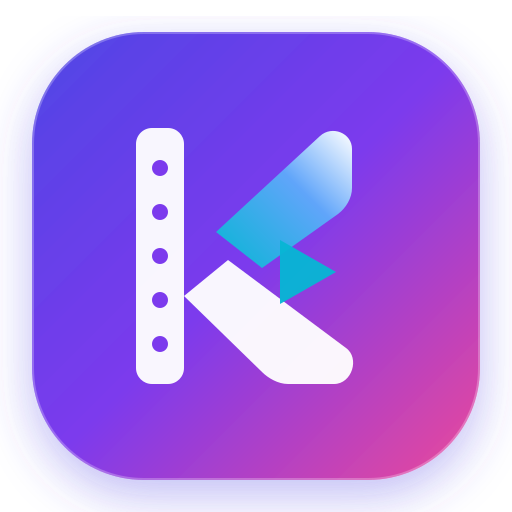

<p align="center">
  
</p>

<h1 align="center">KROMA STUDIO 🎬✨</h1>

<p align="center">
  <strong>Estudio inteligente para la creación y montaje audiovisual automatizado</strong><br />
  <em>Desarrollado con Node.js, Nuxt 3 (Vue 3 + Nitro), Sharp y FFmpeg</em>
</p>

<p align="center">
  <a href="https://nodejs.org/"></a>
  <a href="https://nuxt.com/"></a>
  <a href="https://vuejs.org/"></a>
  <a href="https://ffmpeg.org/"></a>
  <a href="https://github.com/prettier/prettier"></a>
  <a href="https://eslint.org/"></a>
  <a href="https://opensource.org/licenses/ISC"></a>
</p>

---

## 📑 Tabla de Contenidos

1. [Características Principales](#-características-principales)
2. [Estructura del Proyecto](#-estructura-del-proyecto)
3. [Despliegue con Docker y Dockhand](#-despliegue-con-docker-y-dockhand-recomendado)
4. [Requisitos Previos (Ejecución Local)](#-requisitos-previos-ejecución-local)
5. [Instalación Local](#-instalación-local)
6. [Modos de Ejecución](#-modos-de-ejecución)
   - [Modo 1: Aplicación Web Interactiva (Nuxt)](#1-modo-interfaz-web-nuxt)
   - [Modo 2: Consola / CLI (Scripts Automatizados)](#2-modo-consola--cli)
7. [Endpoints de la API Nitro](#-endpoints-de-la-api-nitro)
8. [Scripts Disponibles](#-scripts-disponibles)
9. [Configuración de Assets](#-configuración-de-assets)
10. [Documentación y Arquitectura](#-documentación-y-arquitectura)
11. [Resolución de Problemas (Troubleshooting)](#-resolución-de-problemas-troubleshooting)

---

## ⚡ Características Principales

- 🌐 **Interfaz Web Nuxt 3 Reactiva**: Dashboard visual con subida Drag & Drop de archivos, galería de assets y reproductor HTML5 integrado.
- 📡 **Seguimiento en Vivo (Server-Sent Events / SSE)**: Barra de progreso en tiempo real con porcentaje y notificación de etapas de FFmpeg directo en el navegador.
- 🎞️ **Concatenación Inteligente de Vídeos (Video Maker)**: Normalización automática de clips heterogéneos (formatos, tasas de refresco, resoluciones) a H.264/AAC en dos fases con unión ultra rápida por stream copy.
- 🖼️ **Deduplicación Perceptual con Sharp (Collage Maker)**: Identificación y descarte automático de fotografías repetidas analizando mapas de bits crudos a 256px.
- 📐 **Soporte Multiformato (16:9 Horizontal y 9:16 Vertical)**: Genera vídeos listos tanto para YouTube/TV como para TikTok, Instagram Reels y YouTube Shorts.
- 🎵 **Sincronización Rítmica con Audio**: Duración calculada al milisegundo mediante `ffprobe` y distribución temporal homogénea de imágenes.
- 💬 **Incrustación de Subtítulos**: Hardsubbing con soporte para fuentes tipográficas `.ttf` y estilos forzados.

---

## 📁 Estructura del Proyecto

```
media-automation-toolkit/
├── app.vue                  # Layout principal Nuxt con Navbar y Modal SSE
├── assets/                  # Storage local de assets multimedia
│   ├── audios/              # Pistas musicales (.mp3, .wav) y subtítulos (.srt)
│   ├── fonts/               # Tipografías (.ttf, .otf)
│   ├── images/              # Fotografías (.jpg, .png)
│   └── videos/              # Clips de vídeo (.mp4, .mov, .mkv)
├── components/              # Componentes Vue 3 interactivos
│   ├── MediaUploader.vue    # Zona de subida Drag & Drop
│   └── RenderProgressModal.vue # Modal reactivo con progreso SSE y reproductor
├── composables/             # Lógica reactiva reutilizable
│   └── useRenderProgress.ts # Cliente EventSource para stream de progreso
├── docs/                    # Documentación técnica y arquitectura
│   ├── ARCHITECTURE.md      # Diagramas Mermaid (flujo y secuencia)
│   ├── GETTING_STARTED.md   # Guía paso a paso para desarrolladores
│   └── adr/                 # Architecture Decision Records (ADRs)
├── output/                  # Directorio de renderizado final
├── pages/                   # Vistas de la aplicación web
│   ├── index.vue            # Dashboard general y métricas
│   ├── video-maker.vue      # Asistente visual de unión de vídeos
│   └── collage.vue          # Asistente visual de fotos + música + subtítulos
├── scripts/                 # Entrypoints y herramientas CLI
│   ├── collage.maker.js     # Script CLI de collage
│   ├── video.maker.js       # Script CLI de unión de vídeos
│   ├── config/              # Configuración de assets y rutas
│   └── tools/               # Utilidades core (FFmpeg, Sharp, FS)
├── server/                  # Backend Nitro (API Node.js)
│   ├── api/                 # Endpoints REST y SSE
│   └── services/            # MediaService con soporte de eventos
├── nuxt.config.ts           # Configuración de Nuxt & Nitro
├── package.json
└── README.md
```

---

## 🐳 Despliegue con Docker y Dockhand (Recomendado)

La forma más rápida y limpia de ejecutar Kroma Studio en cualquier equipo o servidor (sin necesidad de configurar Node.js o FFmpeg manualmente) es mediante su stack Docker:

```bash
docker compose up -d --build
```
Abre tu navegador en **`http://localhost:3000`** (o la IP del servidor).

- **Persistencia**: Tus archivos en `./assets` y `./output` están montados automáticamente.
- **Dockhand / Portainer**: Compatible con un solo clic. Consulta la guía detallada en [`docs/DOCKER_DEPLOYMENT.md`](docs/DOCKER_DEPLOYMENT.md).

---

## ⚙️ Requisitos Previos (Ejecución Local)

1. **Node.js**: `>= 18.0.0` (LTS recomendada).
2. **FFmpeg & FFprobe**: Instalados y disponibles en el `PATH` del sistema:
   - **Windows**: `winget install Gyan.FFmpeg` o `choco install ffmpeg`
   - **macOS**: `brew install ffmpeg`
   - **Linux**: `sudo apt install -y ffmpeg`

---

## 🛠 Instalación

```bash
git clone https://github.com/jmblanco/media-automation-toolkit.git
cd media-automation-toolkit
npm install
```

---

## ▶️ Modos de Ejecución

### 1. Modo Interfaz Web (Nuxt)
Para trabajar de forma 100% visual desde el navegador:

```bash
npm run dev
```
Abre tu navegador en **`http://localhost:3000`**. Desde allí puedes:
- Arrastrar y soltar fotografías, vídeos, audios y subtítulos.
- Configurar intros, outros y relación de aspecto (16:9 o 9:16).
- Ver la barra de progreso en vivo mientras se procesa el vídeo.
- Ver y descargar el vídeo terminado con un clic.

---

### 2. Modo Consola / CLI
Si prefieres procesar vídeos por terminal o en scripts desatendidos:

- **Montaje de Clips de Vídeo**:
  ```bash
  npm run video-maker
  ```
  *(Salida en `output/montaje_final.mp4`)*

- **Collage Fotográfico Musical**:
  ```bash
  npm run collage-maker
  ```
  *(Salida en `output/video_final.mp4`)*

---

## 🌐 Endpoints de la API Nitro

La aplicación cuenta con una API modular bajo `server/api/`:

| Endpoint | Método | Descripción |
| :--- | :--- | :--- |
| `/api/assets` | `GET` | Devuelve el catálogo completo de assets clasificados con metadatos. |
| `/api/upload` | `POST` | Subida multipart/form-data de imágenes, audios, vídeos y fuentes. |
| `/api/render/video` | `POST` | Inicia el renderizado de montaje de vídeos en segundo plano. |
| `/api/render/collage` | `POST` | Inicia el collage de fotos + música con deduplicación por Sharp. |
| `/api/render/progress` | `GET` | Stream de Server-Sent Events (SSE) con el progreso porcentual continuo. |

---

## 📜 Scripts Disponibles

| Script | Descripción |
| :--- | :--- |
| `npm run dev` | Inicia el servidor de desarrollo de Nuxt en `http://localhost:3000`. |
| `npm run build` | Compila la aplicación Nuxt y el servidor Nitro para producción. |
| `npm run preview` | Ejecuta el build de producción localmente. |
| `npm run video-maker` | Ejecuta el pipeline de unión de clips vía terminal. |
| `npm run collage-maker` | Ejecuta el pipeline de collage fotográfico vía terminal. |
| `npm run lint` | Comprueba el estilo y calidad de código con ESLint en `scripts/`. |
| `npm run format` | Aplica formateo con Prettier en `scripts/`. |

---

## 📖 Documentación y Arquitectura

- 🏛️ [Arquitectura y Diagramas Mermaid](docs/ARCHITECTURE.md)
- 🚀 [Guía Detallada de Inicio (Getting Started)](docs/GETTING_STARTED.md)
- 📝 [ADR-001: Estandarización de Pipelines Multimedia](docs/adr/ADR-001-media-pipeline-standardization.md)

---

## 🔍 Resolución de Problemas (Troubleshooting)

- **FFmpeg no encontrado**: Instala FFmpeg según la sección de requisitos y añade su carpeta `bin/` al `PATH`.
- **Error al cargar subtítulos**: Comprueba que el archivo `.srt` esté codificado en UTF-8 sin BOM y que la fuente `.ttf` exista en `assets/fonts/`.
