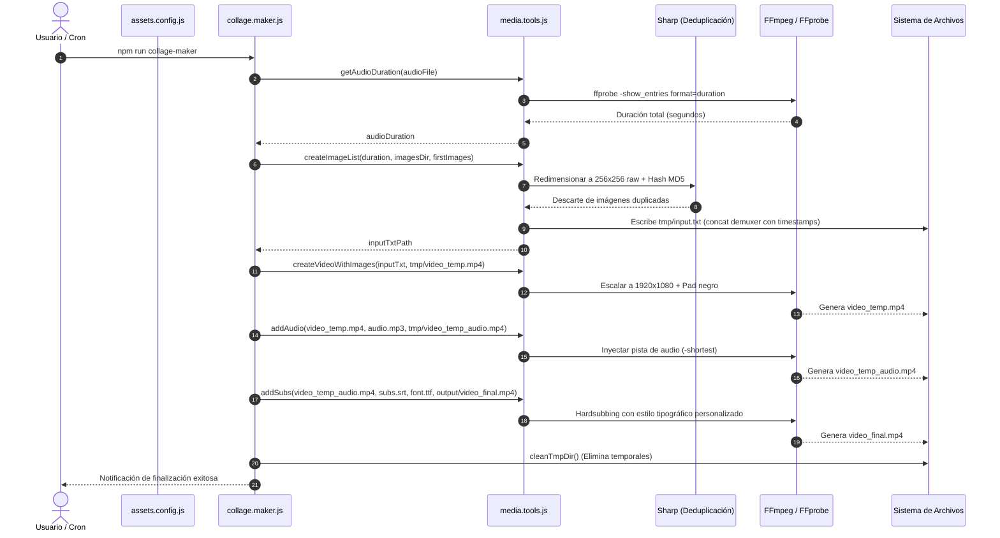
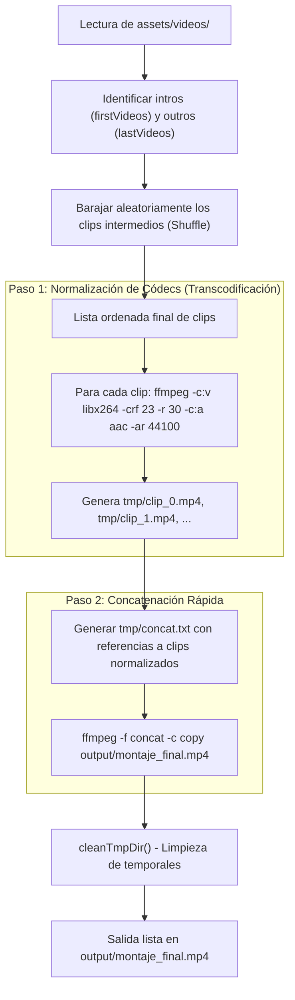

# 🏛️ Arquitectura del Sistema - Media Automation Toolkit

Este documento detalla el diseño de software, pipelines de procesamiento multimedia, flujo de datos y decisiones técnicas de **Media Automation Toolkit**.

---

## 1. Visión General del Sistema

Media Automation Toolkit es un pipeline automatizado en Node.js para composición, transcodificación, sincronización y renderizado de contenidos audiovisuales. Permite ensamblar:
1. **Collages dinámicos de imágenes sincronizados con música y subtítulos** (`collage-maker`).
2. **Montajes y concatenación secuencial de clips de vídeo con normalización de codecs** (`video-maker`).

```
+-------------------------------------------------------------+
|                 Entrada de Assets Multimedia                |
|  - assets/images (JPG, PNG)    - assets/videos (MP4, MOV)   |
|  - assets/audios (MP3, WAV)    - assets/fonts (TTF, OTF)    |
+-------------------------------------------------------------+
                              |
                              v
+-------------------------------------------------------------+
|                Capa de Configuración y Rutas                |
|               (scripts/config/assets.config.js)             |
+-------------------------------------------------------------+
                              |
        +---------------------+---------------------+
        |                                           |
        v                                           v
+-----------------------+               +-----------------------+
| Pipeline: Collage     |               | Pipeline: Video Maker |
| (scripts/collage.maker|               | (scripts/video.maker) |
+-----------------------+               +-----------------------+
        |                                           |
        +---------------------+---------------------+
                              |
                              v
+-------------------------------------------------------------+
|                     Herramientas Core                       |
|   - scripts/tools/fs.tools.js (Gestión de carpetas / tmp)   |
|   - scripts/tools/media.tools.js (FFmpeg, Sharp, Hashing)   |
+-------------------------------------------------------------+
                              |
                              v
+-------------------------------------------------------------+
|                     Motor Multimedia                        |
|            FFmpeg & FFprobe (Sistema Operativo)             |
+-------------------------------------------------------------+
                              |
                              v
+-------------------------------------------------------------+
|                 Salida Final (output/)                      |
|       - montaje_final.mp4      - video_final.mp4            |
+-------------------------------------------------------------+
```

---

## 2. Diagramas de Flujo y Secuencia

### 2.1 Pipeline de Collage (`collage.maker.js`)

El proceso combina deduplicación perceptual de imágenes mediante `Sharp`, cálculo milimétrico de la duración con `FFprobe`, renderizado con filtro de escalado/pillarboxing y fusión de audio y subtítulos `.srt`.



---

### 2.2 Pipeline de Ensamblado de Vídeo (`video.maker.js`)

Garantiza la unión fluida de clips con diferentes resoluciones, tasas de refresco (framerate) o codecs mediante una fase previa de transcodificación homogénea antes de la concatenación `stream copy`.



---

## 3. Desglose Modular de Componentes

### 3.1 `scripts/config/assets.config.js`
- **Responsabilidad**: Fuente única de verdad para rutas de directorios, resolutores de archivos multimedia y listas de ordenamiento prioritario (`firstImages`, `firstVideos`, `lastVideos`).
- **Aislamiento**: Evita el uso de rutas relativas dispersas mediante `path.join(__dirname, '../..')`.

### 3.2 `scripts/tools/fs.tools.js`
- **Responsabilidad**: Operaciones de sistema de archivos.
- **Funciones**:
  - `ensureDirs()`: Inicializa directorios `output/` y `tmp/` si no existen.
  - `cleanTmpDir()`: Purga de manera recursiva la carpeta de trabajo temporal tras la generación del montaje o ante errores.

### 3.3 `scripts/tools/media.tools.js`
- **Responsabilidad**: Núcleo de computación multimedia.
- **Técnicas clave**:
  - **Deduplicación perceptual de imágenes**: En lugar de hash SHA256 del binario original (que falla si cambian metadatos EXIF), normaliza la imagen con `Sharp` a 256 píxeles, elimina canal alfa y calcula el MD5 del mapa de bits crudo.
  - **Concat Demuxer de FFmpeg**: Utiliza archivos descriptores de texto (`tmp/input.txt` y `tmp/concat.txt`) para alimentar a FFmpeg sin sobrecargar la memoria de la máquina.
  - **Filtros de escalado y padding**: Asegura resolución Full HD (1920x1080) preservando el ratio de aspecto original con bordes negros (`force_original_aspect_ratio=decrease`).

---

## 4. Requisitos de Infraestructura y Sistema

| Componente | Requisito | Propósito |
| :--- | :--- | :--- |
| **Node.js** | `>= 18.0.0` | Soporte para `Array.prototype.at()` y APIs modernas de stream/fs. |
| **FFmpeg** | `>= 4.x` / `5.x` / `6.x` | Codificación x264, AAC, filtros de video y subtitulado. |
| **FFprobe** | Incluido con FFmpeg | Detección síncrona de metadatos de duración y streams. |
| **SO** | Windows, Linux o macOS | Compatible multiplataforma (rutas normalizadas con `path`). |

---

## 5. Consideraciones de Resiliencia y Rendimiento

1. **Gestión de Streams en Windows**:
   - En sistemas Windows NTFS, la descarga de archivos desde navegadores web adjunta Alternate Data Streams (`Zone.Identifier`). El `.gitignore` y el ciclo de vida del repositorio deben excluir estos streams para no romper el índice de Git ni fallar en lectura de archivos.
2. **Reencodeo secuencial vs paralelo**:
   - El transcodificado actual procesa clips uno a uno recursivamente para evitar saturar la CPU o la memoria de la máquina anfitriona.
3. **Manejo de directorios bloqueados**:
   - FFmpeg en Windows puede mantener descriptores abiertos momentáneamente tras finalizar un proceso. Es recomendable envolver `cleanTmpDir()` en reintentos o pequeñas esperas asíncronas para evitar errores `EBUSY`.
